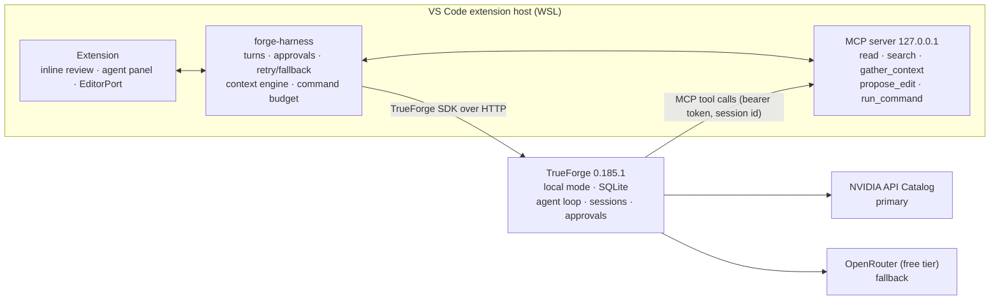

# Forge: a VS Code coding agent on TrueForge

> **Round-1 submission:** the code as submitted is tag [`round1-submission`](../../tree/round1-submission). `main` is
> frozen (tag `round1-final`); later work lives on branches (current: `harness/p14-trueforge-depth`).

Techfest Team ID: TM-C5CB9D87285 · Team: Riya Jenson (`riyajenson`), Shriya Prasad Sawant (`shriyapsawant21-wq`),
Akil Ansari (`dumbly-smart`), Divyam Agrawal (`divyamagrawal06`), all Vellore Institute of Technology, Vellore · Demo video: https://drive.google.com/file/d/1iol4V8OX0IGQ95BHoVEmTl59FTz9snNn/view?usp=sharing ·
Write-up: [`docs/writeup/WRITEUP.pdf`](docs/writeup/WRITEUP.pdf)

Forge is a VS Code-native coding agent whose entire agent loop (sessions, turns, model calls and tool
approvals) runs on **[TrueForge](https://github.com/truefoundry/trueforge) 0.185.1** in local mode. The agent
works through MCP editor tools. You review every change hunk by hunk. The context is assembled within a token
budget and its rationale is shown. If the primary model fails before anything was written, the turn falls back
automatically to a model from another provider, in a fresh TrueForge session; and the harness enforces a per-turn
command budget. **No keys?** [Run with the mock](#run-with-the-mock-no-keys-from-a-clean-clone).

Built for the TrueFoundry Forge-a-thon (Techfest IIT Bombay), Round 1.

## Demo

- **Video:** https://drive.google.com/file/d/1iol4V8OX0IGQ95BHoVEmTl59FTz9snNn/view?usp=sharing
- **Screenshots:** pending; the shots needed are listed in [`docs/images/README.md`](docs/images/README.md).
  <!--  -->
  <!--  -->
  <!--  -->
  - `docs/images/inline-review.png`: inline diff review (Task A)
  - `docs/images/agent-panel-context.png`: agent panel with the Context block (Task B)
  - `docs/images/fallback-banner.png`: the fallback banner (Task C)

## Eligibility at a glance

| Requirement (problem statement) | How Forge meets it | Where |
|---|---|---|
| TrueForge owns the agent loop, sessions, turns and model calls | Every editor turn is a TrueForge session/turn (`createTurnStream`, `subscribeToTurn`, `createTurnEvents`, `sessions.cancel`); the harness never calls a model itself | `src/harness/turn/`, `src/harness/trueforge/` |
| The extension talks to TrueForge through its HTTP API / TypeScript SDK, never to a model provider | Only `@truefoundry/trueforge-sdk` is used; there are no provider SDKs | `src/harness/trueforge/sdk.ts`, `src/harness/package.json` |
| Editor operations are MCP tools chosen by the agent | `read_file`, `search_workspace`, `gather_context`, `propose_edit`, `run_command`, and the deferred `find_symbol` and `list_files`, served on 127.0.0.1 with a bearer token | `src/harness/mcp/` |
| Model configuration lives in TrueForge and is not tied to one provider | Providers and models come from `config/models.json`, which the setup script loads into TrueForge. Switching models means editing the file and rerunning the setup | `config/models.example.json`, `scripts/setup-trueforge.mjs` |
| TrueForge in local mode | `npx @truefoundry/trueforge@0.185.1` with SQLite | [Quickstart](#quickstart-with-real-models) |
| Agent definition in the repository | `forge-coder` (agent mode) and `forge-inline` (inline edit), plus `-fallback` variants created by the setup | `agent/forge-coder.json`, `agent/forge-inline.json` |
| Inline edit with in-editor diff, accept/reject, no copy-paste | Native diff editor whose proposed side updates with the checked hunks; the workspace stays untouched until submit | `extension/src/inlineReview.ts`, Task A |
| Agent mode: one request, ≥ 3 files found and edited | The agent finds the files itself; every proposed change is reviewed before it is written (a file can get several reviews). Passed on real models in the first round-1 build (tag `round1-submission`); on this updated build 3 of 3 real runs passed 6/6 (`f2f87bb`) and the A/B/C rehearsal passed (`d1f4c68`, 21 Nov), details in `docs/writeup/rehearsal.json`. The mock B is scripted (it supplies the paths and edits) | `agent/forge-coder.json`, Task B |
| Context: `@file`, `@symbol`, automatic retrieval, budget, visible rationale | Context engine and the panel's Context block | `src/harness/context/`, [How context is selected](#how-context-is-selected) |
| Diff safety: preview, per-hunk accept/reject, no silent writes, undo | Review before write, stale-base refusal, guarded undo | [Safety model](#safety-model) |
| Streaming and cancellation, workspace consistent | Streamed text and tool calls; Stop cancels the TrueForge turn and closes the review; an approved edit already handed to VS Code is saved and reported before the turn ends | `src/harness/turn/turn.ts`, `extension/src/agentPanel.ts` |
| Fixed tasks A, B and C on Flask 3.1.3 | Exact steps and verification commands | [Running Tasks A, B and C](#running-tasks-a-b-and-c) |
| Fork disclosure | Built from scratch, not a fork | [Starting point](#starting-point-versions-and-licence) |

## Architecture

The extension runs inside VS Code's extension host. It holds the **harness** (`forge-harness`), which maps each
editor turn to a TrueForge session/turn through the TrueForge SDK, and an **MCP server** on 127.0.0.1 that
exposes the editor as tools. TrueForge runs the agent loop: it calls the configured model providers, and calls
the editor's MCP tools when the model asks for them. Tools that change something (`propose_edit`,
`run_command`) pause the TrueForge turn until you decide.



How one turn runs:

1. **Request.** The extension sends the instruction, the selection or `@` mentions, and your settings to the
   harness. The harness assembles context within the budget, shows the Context block, and starts a TrueForge
   turn on `forge-coder` (agent) or `forge-inline` (inline).
2. **Agent loop.** TrueForge calls the model, which picks tools. Read-only tools run straight away against
   the MCP server: `read_file`, `search_workspace`, `gather_context`, and `find_symbol` and `list_files`
   through TrueForge's `call_tool`.
3. **Approval pause.** `propose_edit` and `run_command` pause the turn (`tool.approval_required`). For an edit,
   the harness computes the hunks and opens the review. For a command, it applies the command budget,
   auto-approval and the ⚠ Unrestricted flag, then asks you if needed.
4. **Decision.** Your decision goes back to TrueForge as allow or deny; a deny reason reaches the model. On
   allow, TrueForge calls the MCP tool, which writes only the accepted hunks through the editor (hash-checked,
   saved) or runs the approved command once.
5. **Streaming.** Text, tool calls, results, reviews and command requests stream into the panel. Stop cancels
   the TrueForge turn and closes the approval gate. When an agent-mode request would exceed 40k input tokens,
   TrueForge compacts the conversation into a summary (`context_management.compaction` in
   `agent/forge-coder.json`; inline: 60k). The panel's status line shows "Compacting context: …" and "Context
   compacted in … s", and the activity list keeps a "Context compaction" row. In Task B it fires once, after the
   first edit (`docs/harness/REHEARSAL-P14.md`).
6. **Recovery.** A model error before any write is retried once, and a 429 first waits for the provider's
   `Retry-After`. Otherwise the turn falls back to the `-fallback` agent on a different provider, which starts
   a **fresh TrueForge session** (it does not see earlier panel turns). There is **no retry or fallback after a
   write**, or while a tool call is unsettled: the turn ends with the error. Errors are classified from the
   provider's status and wording. The free OpenRouter fallback serves the same model from NVIDIA's backend and
   has a daily cap (50 requests without credit), so it covers throttling and key problems, not an NVIDIA outage.
   **Resume (branch `harness/p14-trueforge-depth`):** when a turn stops on a rate limit (429), for example after
   edits were saved, the panel offers **Resume** after about a minute. Resume sends the same request as a new turn
   in the same TrueForge conversation, tells the model which files are already changed, and carries over what the
   interrupted turn used of the command budgets. A turn can be resumed once. The same Resume is offered when the
   model stops responding after the turn changed files: while a model request is in flight the silence limit is
   120 s (`forge.watchdog.modelRequestSec`), 45 s for other waits.
7. **Sub-agents (on by default).** Setup enables TrueForge's dynamic sub-agents for `forge-coder` (not inline)
   and tells the agent that `create_sub_agent` is available: at most one read-only exploration sub-agent per
   task, with edits and commands left to the main agent. Whether to delegate is the model's choice (Nemotron did
   not delegate in 4 real runs). `node scripts/setup-trueforge.mjs --no-subagents` turns them off. A sub-agent's edits and
   commands still go through the same review and budgets. The panel lists each one as "Sub-agent: <name>" with
   its task and outcome, and the status line shows "Delegated to sub-agent …".
8. **Review safeguards.** A hunk that deletes a whole Python class or function is flagged in the review (the hunk
   list and the prompt title name it with its line count, for example "deletes class TestRoutes (25 lines)") and
   listed under "Destructive hunks" in the panel. When an agent turn ends, the panel shows the **observed** result
   of the last test command next to the model's summary ("Tests (observed): 1 failed — 1 failed, 57 passed …",
   "passed", or "not run in this turn"), taken from the command's exit code and output, not from the reply.

## Quickstart with real models

All models below are **free tiers ($0)**. These are the models tested on Tasks A, B and C.

### 1. Prerequisites

- Windows 11 with **WSL 2 (Ubuntu)**, or any Linux. Every command below runs in WSL or Linux.
- **VS Code**: on Windows with the **WSL** extension (Remote-WSL); on Linux, VS Code itself.
- **Node.js ≥ 22.14** (for example `nvm install 24`), npm, git.
- **Python ≥ 3.10** with `venv`.
- **bubblewrap** (`sudo apt install bubblewrap` on Ubuntu/WSL) for protected commands. Check it with
  `bwrap --unshare-all --ro-bind / / --proc /proc --dev /dev -- true`. Without it, `run_command` refuses to run
  anything (fail closed); editing and model calls still work. See `docs/harness/EXECUTION-SAFETY.md`.
  On generic Linux the check can fail with `setting up uid map: Permission denied` where unprivileged user
  namespaces are restricted (for example Ubuntu 24.04's AppArmor setting
  `kernel.apparmor_restrict_unprivileged_userns=1`); allow them for bwrap per your distribution's guidance.
- Internet access: npm, TrueForge through `npx`, the model providers, GitHub (for Flask).

### 2. Install and build

```bash
git clone https://github.com/riyajenson/forgeathon.git && cd forgeathon
npm --prefix src/harness ci && npm --prefix src/harness run build
(cd extension && npm ci && npm run compile)
```

### 3. Get free API keys

You need the primary (NVIDIA) and the fallback (OpenRouter). Groq is an optional spare.

1. **NVIDIA API Catalog** (primary):
   1. Open https://build.nvidia.com and sign in or create an NVIDIA account.
   2. Verify your phone number when asked. The free tier needs it.
   3. Open any model page, click **Get API Key** and copy the key. It starts with `nvapi-`.
   4. The free tier allows about 40 requests per minute.
2. **OpenRouter** (fallback):
   1. Open https://openrouter.ai and sign in.
   2. Go to **Keys → Create Key**. The key starts with `sk-or-`.
   3. Free models (ids ending in `:free`) cost nothing per request, but OpenRouter caps them per day: its
      documentation says 50 requests a day on an account that never bought credit, 1,000 after a one-time
      purchase of $10. One Task B takes about 40–70 model requests (`docs/STATUS.md`), so without credit the
      fallback covers Tasks A and C and at most one Task B, possibly not a whole one.
3. **Groq** (optional spare):
   1. Open https://console.groq.com and sign in.
   2. Go to **API Keys → Create API Key** and copy the key. It starts with `gsk_`.
   3. The free tier allows about 7,000 input tokens per minute for this model: enough for Tasks A and C,
      too few for Task B's ~11k-token requests (measured: HTTP 413).

Store the keys in a file only you can read, and load it in each terminal you use:

```bash
cat > ~/.forge-keys.env <<'EOF'
export NVIDIA_API_KEY='nvapi-...'
export OPENROUTER_API_KEY='sk-or-...'
export GROQ_API_KEY='gsk_...'             # optional spare
EOF
chmod 600 ~/.forge-keys.env
source ~/.forge-keys.env
```

Never commit this file or paste keys into `config/models.json`. The config names only the environment variables.

### 4. Configure the models

```bash
scripts/use-models.sh nvidia-free     # writes config/models.json (gitignored) and runs the setup of step 6
```

Before TrueForge runs (step 5), `cp config/models.example.json config/models.json` gives the same file; the
script is for switching later. The defaults (profile `nvidia-free`):

| Role | TrueForge model | Provider model id | Free tier |
|---|---|---|---|
| Primary | `nvidia/nemotron-3-ultra` | `nvidia/nemotron-3-ultra-550b-a55b` (NVIDIA API Catalog) | ≈ 40 requests/min |
| Fallback | `openrouter/nemotron-3-ultra-free` | `nvidia/nemotron-3-ultra-550b-a55b:free` (OpenRouter) | 50 requests/day without credit (1,000 after buying $10) |
| Spare: configured; used as fallback in earlier rehearsals, before OpenRouter replaced it | `groq/qwen3-8-27b` | `qwen/qwen3.8-27b` (Groq) | ≈ 7,000 input tokens/min: not enough for Task B |

The fallback is the same model through another provider: its own key, account and quota, and its context
(1M tokens) and token rate carry Task B's requests, which Groq's free tier refuses; the daily cap above is its
limit. OpenRouter currently serves this free model from
NVIDIA's own endpoint, so it covers NVIDIA rate limits and key problems, not an outage of NVIDIA's service.

**Profiles** (no code change to switch; `scripts/use-models.sh --list`):

| Profile | Primary | Fallback | When |
|---|---|---|---|
| `nvidia-free` (default) | NVIDIA free tier | OpenRouter free tier | Normally |
| `openrouter-free` | OpenRouter free tier | NVIDIA free tier | If NVIDIA throttles (429) on recording day. Without OpenRouter credit, 50 requests/day may not finish one Task B |
| `openrouter-paid` | `qwen/qwen3-coder-next` on OpenRouter (**paid**) | NVIDIA free tier | Only after adding OpenRouter credit; refused without `--paid-ok` |

`scripts/use-models.sh <profile>` rewrites `config/models.json` from the example with that pair (the previous
file is kept as `config/models.json.bak`) and reruns the setup. `node scripts/preflight-model.mjs` sends one
tiny request to the primary model and recommends a profile if it gets a 429.

Free model lists change. To pick another model:

1. List what your key can use:
   `curl -s -H "Authorization: Bearer $NVIDIA_API_KEY" https://integrate.api.nvidia.com/v1/models`.
   The same works for Groq at `https://api.groq.com/openai/v1/models`.
2. Choose a coding model that supports tool (function) calling. A model that does not return `tool_calls`
   cannot drive the agent.
3. Add it under its provider in `config/models.json`.
4. Point `agents.primaryModel` or `agents.fallbackModel` at it. Keep the two on **different providers**.
5. Rerun the setup (step 6).

Which models were used for what:

- **Used for the tasks and the video:** the primary and fallback above. Until 2026-11-19 the fallback was
  Groq `qwen/qwen3.8-27b` (Task C runs and the rehearsal in `docs/STATUS.md`); it is now the spare.
- **Probed only** (one request each, not used for the tasks): on NVIDIA, Kimi K3.1 Pro, GLM-5.3 Flash, Step-5,
  Mistral Large 4 and MiniMax M3.1 Flash (`docs/STATUS.md`, "Models").
- **Examples only, never run:** Gemini, Anthropic, OpenAI and `groq/gpt-oss-120b` in `config/models.example.json`.

### 5. Start TrueForge (keep this terminal open)

```bash
OUTBOUND_URL_ALLOWED_HOSTS='["127.0.0.1","integrate.api.nvidia.com","openrouter.ai","api.groq.com"]' \
  MODEL_HTTP_CONNECT_TIMEOUT_MS=3000 MODEL_HTTP_MAX_RETRIES=4 \
  SQLITE_PATH=$HOME/forge-data/trueforge.sqlite npx -y @truefoundry/trueforge@0.185.1
```

`OUTBOUND_URL_ALLOWED_HOSTS` lets TrueForge reach the editor's MCP server on 127.0.0.1; its SSRF guard blocks
loopback otherwise. The three provider hosts are listed because some networks (for example WSL behind NAT64)
resolve them to `64:ff9b::…` addresses, which the guard treats as private and refuses
(`Outbound URL blocked for host "integrate.api.nvidia.com"`); listed hosts skip that address check.

`MODEL_HTTP_MAX_RETRIES=4` is the rate-limit cushion. TrueForge 0.185.1 resends a model request that gets 429,
408, 409, 502, 503 or a 52x/530 gateway error up to that many times, before any output is streamed. It honours a
`Retry-After` of up to 5 s; otherwise it waits 1, 2, 4, 8 s (±10 %), so about 15 s at most, inside the
harness's silence limit (120 s while a model request is in flight, 45 s otherwise). These resends happen below the turn: no tool runs twice, and the harness's own
rule (at most one retry, never after a change was applied) is unchanged. 401 and 500 are not resent, so the
fallback for an invalid key is still immediate; a host that never answers (connect timeouts are resent too)
takes about 30 s before the fallback.

### 6. Load providers, connector and agents

In a second terminal:

```bash
cd forgeathon && source ~/.forge-keys.env
node scripts/setup-trueforge.mjs             # idempotent; --dry-run prints the plan with keys redacted
```

The setup:

- registers every provider whose key is set;
- registers the `vscode` MCP connector;
- creates four agents from `agent/*.json`: `forge-coder` and `forge-inline` on the primary model, and
  `forge-coder-fallback` and `forge-inline-fallback` on the fallback model.

It ends with `models available: nvidia/nemotron-3-ultra (primary), openrouter/nemotron-3-ultra-free (fallback)`.
`scripts/use-models.sh <profile>` runs this same setup after writing the profile's config.

### 7. Open the TrueForge UI

Open http://localhost:8790. The **Sessions** page shows every turn, its tool calls and approvals.

### 8. Prepare the Flask 3.1.3 workspace

This is the fixed demo target, at commit `22d92470`:

```bash
git clone https://github.com/pallets/flask ~/flask-demo && git -C ~/flask-demo checkout -q 22d92470
python3 -m venv ~/flask-demo/.venv && echo ".venv/" >> ~/flask-demo/.git/info/exclude
~/flask-demo/.venv/bin/pip install -q -e ~/flask-demo "pytest==9.0.2"   # Flask's lockfile pins pytest 9.0.2
git -C ~/flask-demo status --short                                      # prints nothing
```

### 9. Launch the extension (Remote-WSL, or Linux directly)

1. On Windows, run **WSL: Connect to WSL** in VS Code, then open the `forgeathon/extension` folder. On Linux,
   just open that folder (`code forgeathon/extension`).
2. Press **F5** (*Launch Forge editor*). An Extension Development Host window opens; it runs in WSL.
3. In that window, open `~/flask-demo`.
4. Open the commands with `Ctrl+Shift+P`, "Forge-a-thon":
   - **Inline Edit** (`Ctrl+Alt+I`)
   - **Open Agent Panel**
   - **Accept All Hunks**, **Reject All Hunks**, **Review Hunks**
   - **Undo Last Reviewed Edit**
   - **Stop Turn**

## Running Tasks A, B and C

Run them in the Extension Development Host on `~/flask-demo`, in the integrated terminal at `~/flask-demo`.

### Task A: inline edit

1. Open `src/flask/helpers.py` and select the whole `get_debug_flag` function.
2. Press `Ctrl+Alt+I` and enter:

   > Treat the values 'off' and 'n' as false as well, case-insensitively, and update the docstring to list
   > every value that is treated as false.

**What you'll see:** a progress notification, then a diff editor and, above it, the hunk picker "Select hunks to
accept", with every hunk checked. The proposed side of the diff updates as you check or uncheck hunks, so it
shows the exact result before submission. **Enter** writes and saves the checked hunks; unchecked hunks are rejected. The
picker's title bar has **✓** (*Accept all hunks*) and **✕** (*Reject all hunks*). Escape hides the picker;
**Review hunks** in the status bar reopens it. **Undo Last Reviewed Edit** restores the file.

**Verify:**

```bash
FLASK_DEBUG=off .venv/bin/python -c "from flask.helpers import get_debug_flag; print(get_debug_flag())"
# False
```

### Task B: agent mode

1. Optional, as in the demo video: set `"forge.autoApproveSafeCommands": true` in the Extension Development
   Host's settings.
2. Open the Agent panel and send, naming no files:

   > Add a new built-in CLI command flask config that prints the loaded application's configuration as JSON,
   > masking the values of any key containing SECRET, PASSWORD, TOKEN or KEY as "\*\*\*". It must appear in
   > flask --help, be covered by a test, and be documented alongside the other built-in commands.

**What you'll see:**

- Streamed text, then the **Context block**, with `src/flask/cli.py` ranked first.
- Tool calls: reads and searches, then one diff per file: `src/flask/cli.py`, `tests/test_cli.py` and
  `docs/cli.rst`.
- The test run, then a summary.
- At turn end, **Files changed in this turn: 3**, listing the three paths together with their review and
  accepted-hunk counts.
- At most 5 commands per turn (`forge.commandBudget.agent`); with a budget of 4 or more, the last 2 are kept for
  test runs (`pytest`, `python -m pytest`), so other commands get at most 3. After that, one rerun of a test command that already
  ran is still allowed once a fix was accepted, so a failing test can always be fixed and checked; any other
  command appears as "command budget reached". A `cd … && …` command is refused before any prompt, without
  using the budget, and the model is told the corrected call.

**What to click:**

| What appears | Click |
|---|---|
| Each diff | **✓** (*Accept all hunks*) in the picker's title bar, or uncheck hunks and press Enter |
| `python -m pytest …` | Nothing if auto-approval is on (an "auto-approved: …" line appears). Otherwise **Allow** |
| A command prompt without a warning (`python -c …`, `flask …`) | **Allow** if you agree with it |
| A prompt marked **⚠ Unrestricted** (pipes, here-docs, `python -m flask …`) | **Deny**. The reason goes back to the model |

**Verify:**

```bash
.venv/bin/python -m pytest tests/test_cli.py -q
# … passed (no failures)
cd examples/tutorial && ../../.venv/bin/flask --app flaskr --help
# the command list includes:  config  …
../../.venv/bin/flask --app flaskr config
# JSON including "SECRET_KEY": "***"
cd ~/flask-demo
```

### Task C: resilience (fallback)

1. Start from a clean workspace: `git checkout -- . && git status --short` prints nothing.
2. Break the primary model's key in TrueForge. In the setup terminal, inside `forgeathon`:

   ```bash
   scripts/use-models.sh nvidia-free --break-primary      # = NVIDIA_API_KEY=invalid node scripts/setup-trueforge.mjs
   ```

3. Repeat Task A.

**What you'll see:** at once, the banner
"Primary model failed: [Model Error] Request failed (401): Unauthorized → switched to openrouter/nemotron-3-ultra-free"
(also shown as a VS Code notification). Then the fallback model's diff appears, about 8 s after the instruction
(measured 2026-11-19: 1 NVIDIA 401, then 3 OpenRouter requests); the editor stays responsive.

**Click:** **✕** (*Reject all hunks*) in the picker's title bar.

**Verify:**

```bash
git status --short
# (nothing: the workspace is unchanged)
```

**Restore the primary:**

```bash
source ~/.forge-keys.env && scripts/use-models.sh nvidia-free
```

## How context is selected

- **Pinned first:** the selection, `@symbol:Name` (resolved through a Python def/class index), `@file:path`,
  and an outline of the active file.
- **Chunking:** the workspace is split into functions and classes (with decorators) and doc sections,
  respecting every `.gitignore` and skipping dependencies, virtualenvs, build output and credentials files.
  If a `.gitignore` exists but cannot be read, nothing is indexed, listed or searched, and the reason is shown.
- **Scoring:** identifiers are split (`routes_command` → `routes`, `command`), and chunks are scored with BM25
  plus symbol-name, decorator and file-name boosts.
- **File ranking:** a file's score sums its best chunks and its coverage of the task's terms. Code is weighted
  above docs and tests.
- **Neighbour bonuses:** docs and tests rise through these: `src/x.py` → `tests/test_x.py`, docs that mention
  the module or its symbols, and one-hop imports. Changelogs are down-weighted.
- **Packing:** outlines of the top files come first, then whole functions and sections, until the budget is
  reached. Anything that does not fit is listed as skipped.
- **More on demand:** the agent can ask for more context with the `gather_context` tool.
- **Budget:** `forge.context.budgetTokens` (default 4000 tokens, estimated as characters ÷ 4; every agent request resends
  the context, so a larger budget multiplies across a turn's ~30 requests).

**Reading the Context block** in the agent panel:

- The first line is `used / budget estimated tokens`.
- Each item reads `path | symbol | source | rationale | tokens`. The source is `selection`, `explicit` (an `@`
  mention), `active` or `automatic`. The rationale is the plain-English reason, for example
  `matches "config", "command" (n of m task terms)`.
- **Skipped** lists what did not fit, with the reason.

On Flask 3.1.3, Task B packs 7,456 of 8,000 tokens (28 items, 7 skipped), with `src/flask/cli.py` first and
`tests/test_cli.py` and `docs/cli.rst` included.

## Safety model

- **Review before write:**
  - `propose_edit` never writes by itself. Only the hunks you accept are applied, through one VS Code
    text-only `WorkspaceEdit` containing just those hunk ranges, and then saved. VS Code applies a text-only
    workspace edit atomically; if one range cannot be applied, none of the accepted hunks are applied.
  - The result is one of six reported outcomes (stale, approval missing, failed before apply, applied but
    unsaved, save failed, saved).
- **Per hunk:** accept or reject each hunk, or all of them.
- **Live preview benchmark:** for two hunks, the extension-host test checks all four accept/reject combinations.
  The old static diff matched the selected result in 1/4 states (25%); the live diff matches 4/4 (100%), a
  4× increase in preview-state coverage. This measures whether the shown result matches the checkboxes, not review time.
- **Apply:** the reviewed text (the original with only the accepted hunks) is verified by hash before it is
  saved; save-time formatters (format on save) may alter the saved file, and the receipt records the post-save hash.
- **Undo:** restores the reviewed original text, verified by hash (saved without save participants), after
  checking the file has not changed since.
- **Hunk edit footprint:** the extension-host test applies two accepted hunks, rejects a third, and then undoes in a
  93,936-character file. Apply plus undo submits 116 characters of ranges and replacement text, versus 375,756
  characters for whole-document replacements: a 99.97% smaller edit footprint. This measures editor edit scope,
  not human review time. If saving changes the reviewed postimage (for example, a formatter rewrites the file),
  undo falls back to the hash-guarded full snapshot so it can still restore the exact original.
- **Review actions:** the direct multi-select picker uses one submit action instead of two in the prior nested
  picker flow, a measured 50% reduction in picker submissions; this is an interaction count, not elapsed time.
- **Stale-base refusal:** an edit is based on the file's sha256. If the file changed since it was read, the
  edit is refused (in both the harness and the editor), and the model is told to read it again.
- **Cancel:**
  - Stop closes the approval gate, cancels the TrueForge turn, closes any open review without writing, and
    kills a running command's process group.
  - An approved command never starts after Stop.
  - If Stop arrives after an approved edit was handed to VS Code, the turn waits (bounded) for it: the edit is
    saved and reported as saved before the turn ends, never left unsaved in the buffer.
  - Edits saved earlier in the turn stay, so a stopped multi-file task can be partly done (the panel lists them).
- **run_command gating:**
  - Each command needs your approval of that exact command and directory, used once.
  - Any command other than `pytest`, `python -m pytest`, `python -c`, `flask`, `git status` and `git diff`
    (without shell operators) is marked **⚠ Unrestricted** with a warning.
  - The working directory must resolve inside the workspace.
  - **Protected execution (bubblewrap):**
    - Only the system runtime (`/usr`, `/etc`, `/lib*`), the workspace and its virtualenv (with the Python it
      was made from) are mounted, all read-only, so a command cannot edit source files. Your home directory
      (`~/.ssh`, `~/.forge-keys.env`, other checkouts) does not exist inside, and this repo's `config/models.json`
      reads as empty. `/tmp` is private and disposable, and there is no network.
    - Only `PATH`, `VIRTUAL_ENV` and the locale are passed: no API keys.
    - Command output is redacted before it reaches the model, the panel or the logs: provider keys known to the
      harness (credential-named variables and `apiKeyEnv` in the model config) and common key shapes (`nvapi-`,
      `sk-…`, `gsk_`, `ghp_`, AWS keys, PEM private keys, `Bearer …`, `API_KEY=…`) become `[REDACTED]`.
    - Without bubblewrap the command is refused; there is no unprotected fallback.
  - A timeout (default 120 s, maximum 600 s) and an output cap apply.
  - As a backstop, `git status` before and after reports any file that still changed "outside review".
- **Command budget:**
  - The harness, not the model's instructions, allows at most 3 commands per agent turn and 1 per inline turn,
    whether asked or auto-approved.
  - Further `run_command` calls are refused to the model with "command budget for this turn exhausted; stop
    running commands, finish edits and summarize". You are not asked, and the panel shows "command budget
    reached".
- **Auto-approval scope** (`forge.autoApproveSafeCommands`, off by default):
  - Only bare `pytest`, `python -m pytest`, `git status` and `git diff`, with no shell operators and no path or
    `NAME=value` prefix.
  - `python -c` and `flask` always ask. Edits are always reviewed.
- **What the model can read:** one rule applies to every source of text: automatic retrieval, `@file`,
  `@symbol`, the selection, the active file, `read_file`, `search_workspace`, `list_files`, `find_symbol` and
  `gather_context`.
  - Credentials-shaped files (`.env*` other than `.env.example`/`.sample`/`.template`; `*.pem`, `*.key`, `*.p12`,
    `*.pfx`, keystores; `id_rsa`-style keys; `.netrc`, `.npmrc`, `.pypirc`, `.git-credentials`,
    `credentials.json`, `secrets.json/.yaml`) are refused everywhere. A refused `@file` or selection appears under
    **Skipped** with the reason, and a tool call gets a `SECRET_FILE` error.
  - Files with NUL bytes are refused (`BINARY_FILE`) and are not searched. `read_file` returns at most 600
    lines and 60,000 characters, cuts lines longer than 2,000 characters, and marks every cut.
  - Ignored and default-excluded files are left out of automatic retrieval, listing and search, but an
    explicit `read_file` or `@file` can still read them.
  - The rule is name-based: a secret stored in an ordinary source file is not detected.
- **Unsettled tools:** if a tool is still running when the model's turn ends, the session stays occupied until
  it finishes (Stop or the command timeout ends it). No retry, fallback or next turn starts in the meantime.
- **Residual risk:** a command you approve can still read every file in the workspace (secrets kept there are
  only caught by the output redaction, which is pattern-based) and use CPU and memory until its timeout. Commands that need the
  network or need to write into the checkout (installs, builds into the tree) fail by design. Deny commands
  you do not understand.

## Settings and environment

| Name | Default | Purpose |
|---|---|---|
| `forge.trueforgeUrl` | `http://127.0.0.1:8790` | TrueForge server |
| `forge.mcpPort` | `47615` | Loopback port of the editor's MCP server (random bearer token, generated each time the server starts) |
| `forge.context.budgetTokens` | `4000` | Agent-mode context budget |
| `forge.context.semanticSearch` | `true` | Use cached local semantic scores for a weak keyword/structure shortlist; cache misses warm in the background |
| `forge.autoApproveSafeCommands` | `false` | Run bare `pytest`, `python -m pytest`, `git status` and `git diff` without asking; each one is shown as "auto-approved: …" |
| `forge.commandBudget.agent` | `3` | Most commands per agent turn, test runs not included |
| `forge.commandBudget.inline` | `1` | Most commands per inline turn (the inline agent does not run commands today) |
| `forge.testCommandBudget.agent` | `3` | Most test runs (`pytest`, `python -m pytest`) per agent turn, counted separately, so a denied or extra command never uses up a test rerun ("test-command budget reached") |
| `forge.testCommandBudget.inline` | `1` | Most test runs per inline turn |
| `forge.watchdog.modelRequestSec` | `120` | Seconds the model may stay silent during a request before the turn is stopped as unresponsive (other waits: 45 s); a stop after changes offers Resume |
| `NVIDIA_API_KEY`, `OPENROUTER_API_KEY`, `GROQ_API_KEY` | (none) | Provider keys, read by the setup script; only those your config uses are needed (default: NVIDIA and OpenRouter) |
| `OUTBOUND_URL_ALLOWED_HOSTS` | (none) | TrueForge: must include `127.0.0.1` so it can call the editor's MCP server |
| `MODEL_HTTP_CONNECT_TIMEOUT_MS`, `MODEL_HTTP_MAX_RETRIES` | TrueForge defaults (5000, 2) | We use `3000` and `4`: a short connect timeout, and TrueForge resends a rate-limited (429) model request up to 4 times (about 15 s) before the turn sees the error |
| `SQLITE_PATH` | TrueForge default | TrueForge's database; a new path starts fresh |
| `FORGE_FLASK_DIR` | `~/projects/flask-3.1.3` | Flask checkout for the context-ranking unit test |

Automatic context ranking combines BM25 keyword matches, identifier/symbol and basename matches, path-term rarity, Python and relative JavaScript/TypeScript imports, reverse importers, and nearby test and documentation files. Structural expansion is bounded to one hop. A direct “CLI command” request also prioritizes a matching CLI entry-point file over output/support modules. Explicit selection and `@file`/`@symbol` references stay pinned ahead of automatic results; the active file contributes a compact outline. Automatic context adds query-focused outlines for at most eight files (up to 120 estimated tokens each), then packs relevant chunks or focused excerpts (up to 600 tokens, and no more than 30% of the context budget per excerpt). The report shows the chosen paths, ranking reasons, omitted ranges, and skipped files. This uses a bounded repo map and targeted excerpts instead of spending the budget on whole large files.

When the top five files cover less than 40% of task terms or the top two scores are within 10%, semantic retrieval can rerank the bounded shortlist. It is enabled by default but uses an optional local install. A default install (`npm ci` in `src/harness`) does not include its runtime and stays the same size as before (about 70 MB of `node_modules`). To use semantic reranking, run `scripts/enable-semantic-search.sh` once. It installs the pinned `@huggingface/transformers` runtime into `src/harness/semantic-runtime/` (about 230 MB, CPU only: ONNX Runtime's CUDA/TensorRT download is skipped, and only this platform's binaries are kept). `--remove` deletes it again. Model files and vectors stay outside the workspace. A fully cached semantic result may rank the current request; on a cache miss, Forge returns lexical/structural context immediately and warms semantic vectors in the background for a later request. If the runtime is absent or inference fails, it keeps the lexical/structural result and reports why. Set `forge.context.semanticSearch` to `false` to turn semantic retrieval off.

### Context-selection benchmark

The benchmark has 13 labeled tasks across Forge and pinned Flask 3.1.3. These are retrieval/packing measurements, not end-to-end coding success. With the extension's default 4,000-token budget, the prior single-run baseline had recall@5 0.699, MRR 0.660, relevant-file density 0.461 files per 1,000 packed tokens, 4.55 ms median assembly, and 9 of 30 expected files packed. The current implementation, measured across three runs with semantic inference deliberately unavailable to isolate lexical/structural selection, had recall@5 0.801, MRR 0.733, density 0.492, 4.04 ms median assembly, and 25 of 30 expected files packed. That is +14.7% recall@5, +11.2% MRR, +6.7% density, 11.1% lower assembly latency, and 9→25 expected files in packed context. It does **not** show a 50% gain on every metric.

At an 8,000-token benchmark budget, the previous run measured recall@5 0.699, MRR 0.660, density 0.244, and 203.16 ms median assembly (including the old semantic wait on a cold/missing runtime). The current three-run median was recall@5 0.801, MRR 0.733, density 0.315, and 4.06 ms assembly. The latency reduction is 98.0%, largely because a semantic cache miss no longer blocks context assembly and lexical ranking is not needlessly recomputed. The 4,000- and 8,000-token figures are different budget settings. Older baseline runs are single directional runs, and their indexed source trees differed slightly as implementation files changed; use these comparisons as directional evidence, not a controlled universal result. Semantic ranking quality itself was not measured in these runs.

Run the paired benchmark from the repository root to compare lexical and hybrid results on the same cases:

```bash
npm --prefix src/harness test
node scripts/bench-context.mjs --mode lexical
node scripts/bench-context.mjs --mode hybrid
node scripts/bench-context.mjs --mode hybrid --budget-tokens 4000
```

The hybrid mode performs both retrieval passes and includes per-case results, quality metrics, and latency in its JSON report. Flask cases are marked unavailable when `FORGE_FLASK_DIR` does not point to a Flask checkout. The fixed Task A/B mock workflow (`scripts/e2e-mock.sh --tasks A,B`) also needs a Flask checkout; pass its location with `--flask PATH`.

The turn log at `~/.forge/turns.jsonl` records model, attempts, tokens, timing and approvals per turn, with no
content.

## Run with the mock (no keys), from a clean clone

The **scripted demo model** stands in for an LLM on loopback. It calls the same tools a real model would and
knows the fixed tasks (it supplies Task B's paths and edits), so everything else is real: TrueForge 0.185.1,
the harness, the MCP tools and the extension. **It is for testing only and is not used in the demo video.**
Prerequisites as in [step 1](#1-prerequisites) (Node ≥ 22.14, Python ≥ 3.10 with venv, git, VS Code, bubblewrap).

```bash
# 1. Bubblewrap check (commands are refused without it; editing still works)
bwrap --unshare-all --ro-bind / / --proc /proc --dev /dev -- true && echo "bubblewrap OK"
# 2. Clone and build both packages
git clone https://github.com/riyajenson/forgeathon.git && cd forgeathon
npm --prefix src/harness ci && npm --prefix src/harness run build
(cd extension && npm ci && npm run compile)
# 3. The pinned Flask 3.1.3 workspace
git clone https://github.com/pallets/flask ~/flask-demo && git -C ~/flask-demo checkout -q 22d92470
python3 -m venv ~/flask-demo/.venv && echo ".venv/" >> ~/flask-demo/.git/info/exclude
~/flask-demo/.venv/bin/pip install -q -e ~/flask-demo "pytest==9.0.2"
# 4. Scripted model + a fresh TrueForge on :8790 (own SQLite under ~/.forge-mock) + setup. Keep this open;
#    Ctrl+C stops everything. (--background returns; stop with: scripts/dev-mock.sh stop)
scripts/dev-mock.sh
```

5. **Editor:** on Linux, `code extension`; on Windows, **WSL: Connect to WSL** and open `forgeathon/extension`.
   Press **F5** (*Launch Forge editor*) and, in the window that opens, open `~/flask-demo`.
6. **Tasks A and B:** as in [Running Tasks A, B and C](#running-tasks-a-b-and-c), with the same instructions
   and verification commands. The TrueForge UI is at http://localhost:8790.
7. **Task C (mock override):** in a second terminal, `scripts/dev-mock.sh --break-primary`, then repeat Task A.
   The banner reads "Primary model failed: … 401 … → switched to demo-fallback/scripted"; click **✕** (*Reject all hunks*);
   `git -C ~/flask-demo status --short` prints nothing. Then `scripts/dev-mock.sh --restore`.

## Testing

Every automated check below uses the scripted model. These checks show that the plumbing works, not that a
real model solves the tasks: the scripted model knows the fixed tasks and, in Task B, supplies the file paths
and edits, so a mock run is no evidence of file discovery. Real-model results: `docs/writeup/rehearsal.json`
(this build; the first round-1 build: tag `round1-submission`) and `docs/STATUS.md` (history). Current counts: 163 unit and 20 integration tests.

| Command | What it proves | Needs |
|---|---|---|
| `npm --prefix src/harness test` | Harness unit tests, and turn races against an in-memory TrueForge stand-in (late writes against retry and fallback; a silent server against Stop) | Nothing. The Flask ranking test needs `FORGE_FLASK_DIR`, otherwise it is skipped |
| `npm --prefix src/harness run test:integration` | Turns through a real TrueForge 0.185.1: approvals, partial accept, deny, cancel races, 401/429/watchdog → retry or fallback, two 429s per model call absorbed by TrueForge's own retries (no harness retry, no duplicate tool call), run_command, setup | TrueForge on :8790 (`scripts/dev-mock.sh --background`) |
| `scripts/e2e-mock.sh` | Tasks A, B, C, G (guardrails) and R (Resume after a scripted 429) through the harness on a copy of Flask 3.1.3, with the verification commands: 24 checks | Flask checkout: `--flask DIR`, default `~/flask-demo` |
| `scripts/e2e-mock.sh --auto-approve-safe-commands --deny-unrestricted` | The same with the video's settings: the test run is auto-approved, and Task G's ⚠ Unrestricted `ls src` is denied | As above |
| `scripts/test-extension.sh` | Extension suites in a real VS Code window: EditorPort, review and the six apply outcomes, undo, Stop during an apply, panel (incl. the turn-end file summary), settings | A display (WSLg, or X/Wayland on Linux). Fetches 3 libraries without sudo |
| `scripts/test-extension-e2e.sh` | Tasks A (incl. undo and re-apply), B, Stop during a pending review and during a running command, and C through the extension's UI code against TrueForge and the demo model | As above, plus the Flask checkout |
| `FORGE_E2E_TEST=responsiveness.cjs scripts/test-extension-e2e.sh` | In a measured scripted Task B run: no extension-host block over 150 ms (event-loop delay, CPU profile summary), no render that takes the webview over 100 ms from receipt to its frame, DOM update p95 ≤ 10 ms, and median event-to-frame latency ≤ 50 ms (control) / 40 ms (streamed text). `FORGE_TEST_INJECT_STALL_MS=200` blocks the extension host once mid-turn and must fail it. A bounded measurement, not a guarantee for every machine | As above |
| `scripts/test-extension-live.sh` | The native UI driven through the DevTools port: inline command, diff tab, hunk picker (hunk 1 only, then hunk 2 only: exactly that hunk saved; the ✓ title button clicked with the mouse saves both, ✕ neither), undo, and no picker left on screen after a decision or Stop | As above, plus TrueForge 0.185.1 in the npx cache |
| `src/harness/node_modules/.bin/tsc -p contracts/tsconfig.json` | The shared protocol types compile | `npm ci` in `src/harness` |
| `node scripts/smoke-real-model.mjs --tasks A,B,C` | The `e2e-mock.sh` checks with your real models (costs real requests) | Keys, `config/models.json`, TrueForge |
| `node --test scripts/submission-readiness.test.mjs` | Tests of the submission-evidence checker | Nothing |
| `node --test scripts/use-models.test.mjs scripts/preflight-model.test.mjs` | Profile switching (paid profile refused without `--paid-ok`, keys never printed) and the pre-flight (one request; 429 → profile advice) against a local fake provider | Built `src/harness` |
| `node scripts/check-submission.mjs` | Checks that the write-up has no placeholders and that `docs/writeup/rehearsal.json` (copied from `config/rehearsal.example.json`) records real A/B/C evidence. It fails until those are filled in; it checks completeness, not truth | The filled-in evidence file |

The unit tests cover:

- the review core and the MCP tools;
- run_command, including the bubblewrap protection, cancel races, the command budget and auto-approval;
- the context engine, including coverage limits and unreadable files;
- setup and errors;
- the model meter.

The smoke script also accepts these options:

- `--auto-approve-safe-commands` and `--deny-unrestricted` answer prompts as in the video.
- `--meter-log` reports requests and 429s per task. It needs `scripts/model-meter.mjs`, a loopback proxy that
  records status, timing, `Retry-After` and tokens, never bodies or keys (usage in the script's header). Its
  `--min-interval-ms 3000` spaces request starts per provider, which keeps a run at 20 requests per minute or fewer.
- `--resume-after-rate-limit` resumes Task B once if it stops on a rate limit, after `--resume-wait-sec` (default:
  the harness's suggestion, 60 s). The run record lists sub-agent delegations and test runs refused by the
  test-command budget.

## Troubleshooting

| Symptom | Fix |
|---|---|
| `Verification requires Linux/WSL with bubblewrap and user namespaces enabled` (in a command result) | Install bubblewrap in WSL/Linux (`sudo apt install bubblewrap`) and check it with `bwrap --unshare-all --ro-bind / / --proc /proc --dev /dev -- true`. Commands are refused until this works |
| `Read-only file system` in a command's output | Expected: commands cannot write to the checkout. Edits go through reviewed diffs; tests may write under `/tmp` |
| `Outbound URL blocked for host "127.0.0.1"` (TrueForge, at setup or on the first tool call) | Start TrueForge with `OUTBOUND_URL_ALLOWED_HOSTS` including `127.0.0.1`, exactly as in step 5 |
| `Outbound URL blocked for host "integrate.api.nvidia.com"` (or `openrouter.ai`) at setup | Your DNS returns NAT64/private addresses for the provider. Start TrueForge with the provider hosts in `OUTBOUND_URL_ALLOWED_HOSTS`, exactly as in step 5 |
| Port in use (`EADDRINUSE` on 8790 or 47615) | Find the process with `ss -ltnp \| grep -E '8790\|47615'` and stop it, often an earlier TrueForge or `scripts/dev-mock.sh stop`. Or change the port: add `--port N` to the TrueForge command and set `forge.trueforgeUrl`; for the MCP server, change `forge.mcpPort` |
| `Request failed (401): Unauthorized` and an immediate fallback, when you did not intend Task C | The key TrueForge has is wrong. `source ~/.forge-keys.env` in the same terminal, then rerun `node scripts/setup-trueforge.mjs` |
| `provider "nvidia" is used by the agents but NVIDIA_API_KEY is not set` | The key is not exported in that terminal; `source ~/.forge-keys.env` |
| 429 rate limit | TrueForge resends the request up to 4 times (about 15 s, step 5); if it still fails, the harness waits for the hint (capped at 30 s), retries once, then falls back to OpenRouter. If NVIDIA keeps answering 429, `scripts/use-models.sh openrouter-free` (check first with `node scripts/preflight-model.mjs`) |
| A model is missing from the free list, or has a 404 or unknown model id | List the models (step 4), pick a tool-calling one, edit `config/models.json` and rerun the setup. The next turn uses it and the panel names it; no restart needed |
| The extension does not load, or Node/npm is not found, under Windows | Open the folder from a **WSL** window (green "WSL: Ubuntu" in the corner), and install Node inside WSL, not only on Windows |
| `TrueForge is not reachable at http://127.0.0.1:8790` | Start TrueForge (step 5) and check http://localhost:8790 opens. If you use another URL, set `forge.trueforgeUrl` |
| `agent "forge-coder" not found; run the setup script` | Run step 6 against the running TrueForge, for example after starting it with a new `SQLITE_PATH` |

## Project structure

```text
agent/        TrueForge agent definitions (forge-coder.json, forge-inline.json)
config/       models.example.json (real providers), models.mock.example.json (demo model)
contracts/    shared TypeScript contract between extension and harness (protocol 0.4.8)
extension/    VS Code extension: commands, inline review, agent panel, EditorPort
src/harness/  forge-harness: TrueForge adapter, MCP server and tools, context engine,
              review core, command budget, demo model, model meter
scripts/      setup, demo mode, end-to-end checks, real-model smoke test, model meter, demo-video recording (demo-recording/)
docs/         status, write-up, demo script, manual test, submission checklist, images
spike/        TrueForge 0.185.1 feasibility spike and findings (not shipped)
```

## Starting point, versions and licence

- **Built from scratch, not a fork.** No editor or agent code was copied from another project. The first
  commit is a TrueForge feasibility spike, and the extension was scaffolded from an empty folder. TrueForge is
  used unmodified.
- **Pinned versions:**
  - TrueForge `@truefoundry/trueforge@0.185.1`, `@truefoundry/trueforge-sdk` 0.185.0
  - `@modelcontextprotocol/sdk` 1.32.2
  - Node ≥ 22.14
  - VS Code ≥ 1.95 (tested on 1.146)
  - Flask 3.1.3 at `22d92470` with `pytest==9.0.2`
  - Exact dependency versions are in the lockfiles.
- **Third-party notices:** `THIRD_PARTY_NOTICES.md`. All dependencies are permissive (MIT, ISC, BSD,
  Apache-2.0).
- **Licence:** MIT (`LICENSE`).
- **No secrets are committed:**
  - Keys come only from environment variables, and `config/models.json` is gitignored.
  - The MCP server listens on 127.0.0.1 with a random bearer token generated when that server starts (one
    server per running harness, not per session). Approvals are bound to the TrueForge session separately.
  - The demo "keys" are dummy values that only the local demo model accepts.

## AI tools used

As declared in the write-up (`docs/writeup/WRITEUP.md`, "Tools used"):

- **Claude** (Anthropic), through the Claude Code CLI and Claude chat: the TrueForge spike, the harness
  architecture and implementation, the context engine and tests. After the hand-over, also the editor
  workstream, the documentation and the write-up draft.
- **OpenAI Codex (via ChatGPT):** the initial VS Code extension scaffold, the editor features (EditorPort,
  inline review, agent panel) and the shared contracts; PRs #3 and #4 (the execution-safety sandbox for
  commands, tool-call settlement, retrieval coverage reporting and the submission-evidence checker); and a QA
  review of the 19 Nov build.

All code was reviewed and directed by the team.

More: `docs/STATUS.md` (what works and how it was verified), `docs/MANUAL-TEST.md`, `docs/DEMO-SCRIPT.md`,
`spike/FINDINGS.md`.
