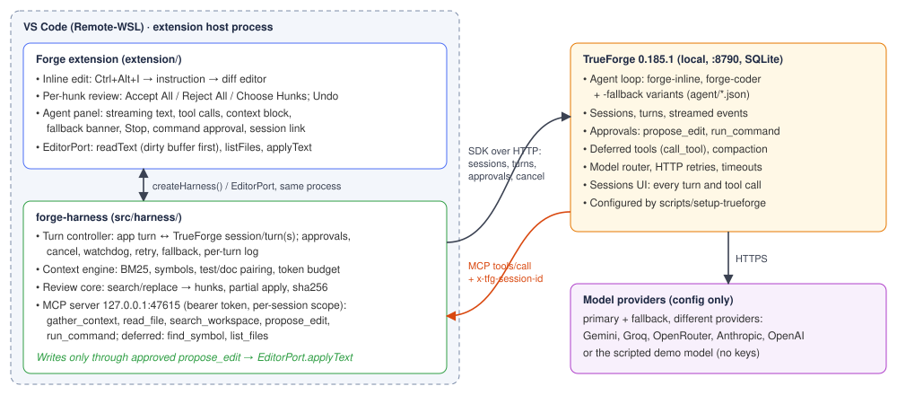

# Forge — a VS Code coding agent on TrueForge

A VS Code extension whose entire agent loop runs on **[TrueForge](https://github.com/truefoundry/trueforge)
0.185.1** in local mode. Built for the TrueFoundry Forge-a-thon (Techfest IIT Bombay), Round 1.

- **Inline edit**: select code, press `Ctrl+Alt+I`, type an instruction, review the diff hunk by hunk, accept, undo.
- **Agent mode**: one request in the panel. The agent finds the relevant files itself, proposes reviewed
  diffs file by file, and runs the tests after asking you.
- **Context assembly**: `@file:`/`@symbol:` mentions, the selection and the active file, plus automatic
  retrieval (BM25 over code, symbol index, test/doc pairing) within a token budget. The panel shows the chosen
  files, the reasons and what was skipped.
- **Diff safety**: proposals never touch disk until you accept them. Per-hunk accept/reject, stale-file
  refusal, and undo restores the exact original bytes, even with format-on-save.
- **Guardrails enforced by the harness, not left to the model's instructions**:
  - Every edit is reviewed by you.
  - Every shell command needs your approval and is flagged if it is outside a short verification list.
  - A per-turn **command budget** (3 for the agent, 1 for inline) refuses further commands without asking you.
  - Shell commands are **not sandboxed**: see [Shell commands](#shell-commands-run_command).
- **Streaming and cancellation**: text and tool calls stream into the panel. Stop cancels the TrueForge turn
  and closes any open review without writing.
- **Resilience**: transient errors are retried (rate limits honour `Retry-After`). On failure the turn falls
  back automatically to a second model from a different provider, but never after the turn has changed the
  workspace.



TrueForge owns the agent loop, sessions, turns, tool approvals and model calls. The extension reaches TrueForge
only through the harness (the TrueForge SDK over HTTP). Editor operations are MCP tools that TrueForge calls.
The models are set in TrueForge's configuration (`config/models.json`, loaded by the setup script); nothing in
the extension depends on a particular provider.

## Contents

1. [Prerequisites](#prerequisites)
2. [Fresh clone to a working demo, without keys](#fresh-clone-to-a-working-demo-without-keys) (about 10 minutes)
3. [Use real models (free tiers)](#use-real-models-free-tiers)
4. [The three fixed tasks](#the-three-fixed-tasks)
5. [Settings](#settings)
6. [Shell commands (run_command)](#shell-commands-run_command)
7. [Tests](#tests)
8. [Repository layout](#repository-layout)
9. [Starting point, licence and attribution](#starting-point-licence-and-attribution)

## Prerequisites

- Windows 11 with **WSL 2 (Ubuntu)**, or any Linux. Every command below runs in WSL or Linux.
- **VS Code** with the **WSL** extension on Windows, so the extension host runs in WSL.
- **Node.js ≥ 22.14** (for example `nvm install 24`), npm, git.
- **Python ≥ 3.10** with `venv`, for the Flask demo workspace.
- Internet access for the first run: npm packages, TrueForge through `npx`, and Flask from GitHub.

## Fresh clone to a working demo, without keys

Demo mode replaces the LLM with a **scripted demo model** running on loopback. It calls the same tools a real
model would, knows the three fixed tasks, needs no keys and costs nothing. Everything else is the real
stack: TrueForge, the harness, the MCP tools and the extension.

**1. Clone and build**

```bash
git clone https://github.com/riyajenson/forgeathon.git && cd forgeathon
npm --prefix src/harness ci && npm --prefix src/harness run build
(cd extension && npm ci && npm run compile)
```

**2. Prepare the demo workspace**

This is Flask 3.1.3, the fixed demo target:

```bash
git clone https://github.com/pallets/flask ~/flask-demo && git -C ~/flask-demo checkout -q 22d92470
python3 -m venv ~/flask-demo/.venv && echo ".venv/" >> ~/flask-demo/.git/info/exclude
~/flask-demo/.venv/bin/pip install -q -e ~/flask-demo "pytest==9.0.2"   # Flask's lockfile pins pytest 9.0.2
```

**3. Check the whole stack headlessly**

About a minute:

```bash
scripts/e2e-mock.sh
```

This starts the demo model and a fresh TrueForge, loads the agents, and runs these tasks on a temporary copy of
`~/flask-demo`, then stops everything:

| Task | What runs |
|---|---|
| A | Inline edit |
| B | Agent: three files edited, then the tests run |
| G | Guardrails: the command budget, and the argument hint on repeated bad edits |
| C | Fallback |

It ends with `all 20 checks passed`. With `--auto-approve-safe-commands` it runs the same checks with
auto-approval on.

**4. Start the demo stack and open the extension**

```bash
scripts/dev-mock.sh            # demo model + fresh TrueForge on :8790 + setup; Ctrl+C stops all
```

1. In VS Code run **WSL: Connect to WSL**, open the `forgeathon/extension` folder and press **F5** (*Launch
   Forge editor*).
2. In the Extension Development Host window, open `~/flask-demo`.
3. Run [the three fixed tasks](#the-three-fixed-tasks).
4. The TrueForge UI at http://localhost:8790 → **Sessions** shows every turn and tool call.

For Task C in demo mode, use `scripts/dev-mock.sh --break-primary` (in a second terminal) and then
`scripts/dev-mock.sh --restore`.

## Use real models (free tiers)

**1. Choose the models**

Pick a primary and a fallback model from **different providers**. The defaults in `config/models.example.json`
are the setup tested on Tasks A, B and C (2026-11-19), on **free tiers only ($0)**:

| Role | Provider (TrueForge name) | Model | Free tier |
|---|---|---|---|
| Primary | NVIDIA API Catalog (`nvidia`) | `nvidia/nemotron-3-ultra-550b-a55b` | ≈ 40 requests/min, monthly allowance |
| Fallback | Groq (`groq`) | `qwen/qwen3.8-27b` | 1000 requests/day, 8000 tokens/min |
| Spare (configured, unused) | OpenRouter (`openrouter`) | `nvidia/nemotron-3-ultra-550b-a55b:free` | 50 requests/day |

```bash
cp config/models.example.json config/models.json      # gitignored
export NVIDIA_API_KEY=...  GROQ_API_KEY=...            # only the variables your providers use
```

To change models, edit `agents.primaryModel` and `agents.fallbackModel`. Gemini, Anthropic, OpenAI and
`groq/gpt-oss-120b` are listed as untested alternatives. Model ids change, so list what your key can use with
`GET <baseUrl>/models`. A model must return proper `tool_calls` to drive the agent; check that before
switching the primary.

**2. Start TrueForge 0.185.1 in local mode**

Keep it running:

```bash
OUTBOUND_URL_ALLOWED_HOSTS='["127.0.0.1"]' MODEL_HTTP_CONNECT_TIMEOUT_MS=3000 MODEL_HTTP_MAX_RETRIES=1 \
  SQLITE_PATH=$HOME/forge-data/trueforge.sqlite npx -y @truefoundry/trueforge@0.185.1
```

TrueForge's SSRF guard blocks loopback addresses. `OUTBOUND_URL_ALLOWED_HOSTS` lets it reach the editor's MCP
server on 127.0.0.1.

**3. Load the providers, the editor connector and the agents**

The setup is idempotent:

```bash
node scripts/setup-trueforge.mjs             # --dry-run prints the plan with keys redacted
```

It registers:

- every provider whose key is set;
- the `vscode` MCP connector;
- four agents built from `agent/*.json`: `forge-coder` and `forge-inline` on the primary model, and
  `forge-coder-fallback` and `forge-inline-fallback` on the fallback model.

To switch models, edit `config/models.json` and rerun the setup.

**4. Check the real models headlessly (optional)**

```bash
node scripts/smoke-real-model.mjs --tasks A,C
```

This runs the same checks as `e2e-mock.sh` and costs real requests. Task B takes 50–70 requests on the
primary.

To count requests and 429s per task, use `scripts/model-meter.mjs`. It is a loopback pass-through proxy that
logs status, duration, `Retry-After` and tokens, never bodies, headers or keys. It sees the retries TrueForge
makes internally, which the harness cannot see. To use it:

1. Copy `config/models.json` and point each `baseUrl` in the copy at `http://127.0.0.1:47800/<route>`.
2. Run the setup with `--config <copy>`.
3. Pass `--config <copy> --meter-log <log>` to the smoke script.

Then open the extension as in step 4 of the demo.

## The three fixed tasks

**Task A: inline edit**

- **Do:** open `src/flask/helpers.py`, select `get_debug_flag`, press `Ctrl+Alt+I` and enter: *Treat the values
  'off' and 'n' as false as well, case-insensitively, and update the docstring to list every value that is
  treated as false.* Review the diff, then Accept.
- **Verify:** `FLASK_DEBUG=off .venv/bin/python -c "from flask.helpers import get_debug_flag; print(get_debug_flag())"`
  prints `False`.

**Task B: agent mode**

- **Do:** in the Agent panel, naming no files, enter: *Add a new built-in CLI command flask config that prints the
  loaded application's configuration as JSON, masking the values of any key containing SECRET, PASSWORD,
  TOKEN or KEY as "\*\*\*". It must appear in flask --help, be covered by a test, and be documented alongside
  the other built-in commands.* Review each file. Allow the test command, and deny anything marked
  ⚠ Unrestricted.
- **Verify:**
  - `.venv/bin/python -m pytest tests/test_cli.py -q` passes.
  - `cd examples/tutorial && ../../.venv/bin/flask --app flaskr --help` lists `config`.
  - `../../.venv/bin/flask --app flaskr config` prints JSON with `"SECRET_KEY": "***"`.

**Task C: resilience**

- **Do:** break the primary model, then repeat Task A and reject the proposal.
  - Demo mode: `scripts/dev-mock.sh --break-primary`.
  - Real models: `NVIDIA_API_KEY=invalid node scripts/setup-trueforge.mjs`.
- **Verify:** the panel banner says "Primary model failed: … → switched to …", and `git status` shows no
  changes.
- **Restore:** `scripts/dev-mock.sh --restore` in demo mode, or rerun the setup with the real key.

Open the extension's commands with `Ctrl+Shift+P`, "Forge-a-thon":

- **Inline Edit** (`Ctrl+Alt+I`)
- **Open Agent Panel**
- **Accept All Hunks**, **Reject All Hunks**, **Review Hunks**
- **Undo Last Reviewed Edit**
- **Stop Turn**

## Settings

| Setting | Default | What it does |
|---|---|---|
| `forge.trueforgeUrl` | `http://127.0.0.1:8790` | TrueForge server |
| `forge.mcpPort` | `47615` | Loopback port of the editor's MCP server (random bearer token per session) |
| `forge.context.budgetTokens` | `8000` | Agent-mode context budget |
| `forge.autoApproveSafeCommands` | **off** | Runs `pytest`, `python -m pytest`, `git status` and `git diff` (bare, no shell operators) without asking; each is shown in the panel as "auto-approved: …" |
| `forge.commandBudget.agent` | `3` | Most commands the agent may run in one turn. More are refused without asking; the panel shows "command budget reached" |
| `forge.commandBudget.inline` | `1` | The same for inline edits (the inline agent does not run commands today) |

## Shell commands (run_command)

The agent runs shell commands (to run the tests) through the `run_command` MCP tool. It is **not a
sandbox**: an approved command runs as you, with your file access, and can change files without hunk review.

The harness enforces the following.

- **Approval:**
  - Nothing runs without your approval of that exact command and directory, and an approval is used once.
  - A command never starts after Stop, and Stop kills its whole process group.
- **Unrestricted flag:** any command other than `pytest`, `python -m pytest`, `python -c`, `flask`,
  `git status` and `git diff` (without shell operators) is marked **⚠ Unrestricted**, with a warning in the
  approval prompt.
- **Command budget:**
  - At most 3 commands per agent turn and 1 per inline turn, whether asked or auto-approved. You can change
    this in `forge.commandBudget.*`.
  - Further `run_command` calls are refused to the model with *"command budget for this turn exhausted; stop
    running commands, finish edits and summarize"*. You are not asked, and the panel shows "command budget
    reached".
  - The budget is enforced by the harness, whatever the model's instructions say. Before the budget existed,
    the real primary model ran 7 and 17 commands in two Task B turns after being told to run at most 2.
- **Auto-approval** (`forge.autoApproveSafeCommands`), off by default:
  - Only bare `pytest`, `python -m pytest`, `git status` and `git diff` with no shell operators run without a
    prompt. A path or `NAME=value` prefix still asks.
  - `python -c` and `flask` are on the verification list but always ask, because they run arbitrary code.
  - Edits are always reviewed hunk by hunk.
- **Workspace and environment:**
  - The working directory must resolve inside the workspace, symlinks included.
  - The command gets your environment **minus** credential-like variables (`*KEY*`, `*TOKEN*`, `*SECRET*`,
    `*PASSW*`, …) and editor IPC handles.
  - It is killed after its timeout (default 120 s, maximum 600 s), and its output is capped.
- **Change reporting:** `git status` is compared before and after the command. Files it changed are reported
  to you and to the model as "changed outside review". A command counts as a write, so there is no retry or
  fallback after it.

**Residual risk:** a command you approve can still:

- write anywhere you can, including absolute paths and git-ignored files;
- reach the network;
- read files.

git cannot see changes to ignored files or to files outside the workspace. Deny commands you do not
understand.

## Tests

| Command | What it proves | Needs |
|---|---|---|
| `npm --prefix src/harness test` | Harness unit tests and turn races against an in-memory TrueForge stand-in (see below) | Nothing. The Flask ranking test needs a Flask 3.1.3 checkout at `FORGE_FLASK_DIR` or `~/projects/flask-3.1.3`, and is skipped otherwise |
| `npm --prefix src/harness run test:integration` | Turns against real TrueForge with a scripted model (see below) | TrueForge on :8790, for example `scripts/dev-mock.sh --background` |
| `scripts/e2e-mock.sh` | Tasks A, B, G (guardrails) and C end to end through the harness, on a copy of Flask 3.1.3, with the verification commands | A Flask checkout: `--flask DIR`, default `~/flask-demo` |
| `scripts/test-extension.sh` | Extension suites inside a real VS Code window: EditorPort, review, panel, settings | A display (WSLg). Fetches 3 libraries without sudo |
| `scripts/test-extension-e2e.sh` | Tasks A, B, Stop and C through the extension UI code, against TrueForge and the demo model | As above, plus the Flask checkout |
| `node scripts/smoke-real-model.mjs --tasks A,C` | The `e2e-mock.sh` checks with your real models. `--meter-log` adds requests and 429s per task | `config/models.json`, keys, TrueForge |

The harness unit tests cover:

- the review core and the MCP tools;
- the ignore policy and the regex deadline;
- run_command cancel races, the command budget and auto-approval;
- the context engine, including Flask ranking;
- setup, errors and the model meter;
- turn races: late writes against retry and fallback, and a silent server against Stop and the watchdog.

The integration tests cover:

- approvals, partial accept, deny and cancel races;
- 401, refused, 429 and watchdog responses leading to retry or fallback;
- run_command;
- setup.

## Repository layout

| Path | What |
|---|---|
| `extension/` | VS Code extension: commands, inline review, agent panel, `EditorPort` (editor reads and writes) |
| `src/harness/` | `forge-harness`: the TrueForge adapter (turns, approvals, cancel, retry, fallback, command budget), the MCP server and tools, the context engine, the review core, the demo model and the model meter |
| `contracts/` | Shared TypeScript contract between the extension and the harness (protocol 0.4.4) |
| `agent/` | **TrueForge agent definitions**: `forge-coder.json` (agent mode), `forge-inline.json` (inline edit) |
| `config/` | `models.example.json` (real providers), `models.mock.example.json` (demo model) |
| `scripts/` | Setup, demo mode, end-to-end checks, real-model smoke test, model meter, extension tests |
| `docs/` | Status, write-up, demo script, manual test, submission checklist, branching convention |
| `spike/` | TrueForge 0.185.1 feasibility spike and its findings (not shipped) |

## Starting point, licence and attribution

- **Built from scratch, not a fork.** No editor or agent code was copied from another project. The first
  commit of this repository is the TrueForge spike, and the extension was scaffolded from an empty folder.
- **Licence:** MIT (`LICENSE`).
- **Third-party components** (listed in `THIRD_PARTY_NOTICES.md`):
  - TrueForge (MIT), the TrueForge SDK (MIT), the MCP TypeScript SDK (MIT), zod (MIT) and TypeScript
    (Apache-2.0).
  - Flask 3.1.3 (BSD-3-Clause) is the demo target and is cloned separately.
- **No secrets are committed:**
  - Keys come only from environment variables, and `config/models.json` is gitignored.
  - The MCP server listens on 127.0.0.1 with a random bearer token per session.
  - The demo "keys" are fixed dummy values that only the local demo model accepts.
- **AI assistance** used to build this project is declared in the write-up (`docs/writeup/WRITEUP.md`, "Tools
  used").

## More

- `docs/STATUS.md`: what works, how it was verified, open items
- `docs/MANUAL-TEST.md`: step-by-step manual check in VS Code
- `docs/DEMO-SCRIPT.md`: the shot list for the video (4 minutes or less)
- `docs/writeup/WRITEUP.md`: the write-up (render it with `scripts/render-writeup.sh`)
- `spike/FINDINGS.md` and `docs/harness/`: TrueForge behaviour verified during development
