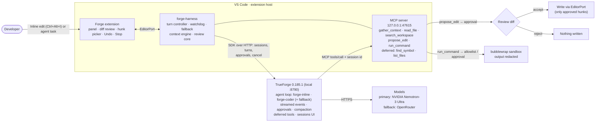

# Forge: a VS Code coding agent on TrueForge

[](https://github.com/riyajenson/forgeathon/actions/workflows/ci.yml)

**Forge is a VS Code coding agent. Its whole agent loop runs on [TrueForge](https://github.com/truefoundry/trueforge),
you review every change hunk by hunk before it is written, and when a model fails it switches to a model from another provider.**

- **Demo video (3:58):** https://drive.google.com/file/d/163YQqkbmGEb9qOgsLrB36MQ8vokfUd3f/view?usp=sharing
- **Write-up (PDF, 3 pages):** [`docs/writeup/WRITEUP.pdf`](docs/writeup/WRITEUP.pdf)
- Built for the TrueFoundry Forge-a-thon (Techfest IIT Bombay), Round 1. Team ID **TM-C5CB9D87285**.

## What it does

The fixed tasks run on [pallets/flask](https://github.com/pallets/flask) 3.1.3 (commit `22d92470`):

- **Task A, inline edit:** select `get_debug_flag` in `src/flask/helpers.py` and press `Ctrl+Alt+I`. The proposed change
  opens as a diff, and you accept or reject each hunk. Nothing is copied or pasted, and the file changes only when you accept.
- **Task B, agent mode:** one request that names no files. It asks for a new built-in `flask config` command that prints
  the configuration as JSON with secret values masked, with a test and docs. The agent finds and edits `src/flask/cli.py`,
  `tests/test_cli.py` and `docs/cli.rst` itself, you review each diff, and it runs the tests.
- **Task C, resilience:** with an invalid primary key or an unreachable endpoint, the turn switches to the fallback model on another
  provider. A banner says why, and the workspace stays unchanged.

Exact steps and verification commands: [`docs/REFERENCE.md`](docs/REFERENCE.md#running-tasks-a-b-and-c).

## How it works



**VS Code extension → harness → local TrueForge agent loop → models, with TrueForge calling back into the editor through MCP tools.**

1. The **extension** (inline review, agent panel) passes your instruction, selection and `@` mentions to the
   **harness** (`forge-harness`), which builds the context within a token budget and starts a TrueForge turn.
2. **TrueForge 0.185.1** (local mode, SQLite) runs the agent loop: sessions, turns, model calls, tool calls and approvals.
   The harness never calls a model provider itself. It uses only the TrueForge SDK.
3. The model works through **MCP tools** that the editor serves on 127.0.0.1. `propose_edit` and `run_command` pause the
   TrueForge turn until you approve. An accepted edit is written hunk by hunk and saved, with a hash check.
4. If the model fails **before anything was written**, the turn retries once and then falls back to a `-fallback` agent on
   another provider. **After a write it never retries.** It stops and offers **Resume**.

The agent definitions are in [`agent/`](agent/), and models are configured in TrueForge from `config/models.json`. Details: [How one turn runs](docs/REFERENCE.md#how-one-turn-runs).

## Quickstart

**Prerequisites:** Linux or Windows 11 with WSL 2 (Ubuntu), VS Code (with the WSL extension on Windows), Node.js ≥ 22.14,
npm, git, Python ≥ 3.10 with `venv`, and **bubblewrap** (`sudo apt install bubblewrap`). Without bubblewrap, commands are
refused, but editing still works.

```bash
git clone https://github.com/riyajenson/forgeathon.git && cd forgeathon
npm --prefix src/harness ci && npm --prefix src/harness run build
(cd extension && npm ci && npm run compile)

# The pinned Flask 3.1.3 workspace
git clone https://github.com/pallets/flask ~/flask-demo && git -C ~/flask-demo checkout -q 22d92470
python3 -m venv ~/flask-demo/.venv && echo ".venv/" >> ~/flask-demo/.git/info/exclude
~/flask-demo/.venv/bin/pip install -q -e ~/flask-demo "pytest==9.0.2"
```

### Option 1: mock mode (no keys)

A scripted model on loopback stands in for the LLM. Everything else is real: TrueForge, the harness, the MCP tools and
the extension. The scripted model knows the fixed tasks, so a mock run tests the plumbing, not the model. It is not used in the video.

```bash
scripts/dev-mock.sh          # scripted model + fresh TrueForge on :8790 + setup; Ctrl+C stops everything
```

Then open the editor (below). For Task C, run `scripts/dev-mock.sh --break-primary` in a second terminal, repeat Task A, and
afterwards run `scripts/dev-mock.sh --restore`.

### Option 2: real models (free tiers)

You need two free keys: an NVIDIA API Catalog key ([build.nvidia.com](https://build.nvidia.com), starts with `nvapi-`) and an
OpenRouter key ([openrouter.ai](https://openrouter.ai), starts with `sk-or-`). Keep the keys in a file only you can read, outside the repository:

```bash
cat > ~/.forge-keys.env <<'EOF'
export NVIDIA_API_KEY='nvapi-...'
export OPENROUTER_API_KEY='sk-or-...'
EOF
chmod 600 ~/.forge-keys.env

# Terminal 1: TrueForge in local mode (keep it open)
OUTBOUND_URL_ALLOWED_HOSTS='["127.0.0.1","integrate.api.nvidia.com","openrouter.ai","api.groq.com"]' \
  MODEL_HTTP_CONNECT_TIMEOUT_MS=3000 MODEL_HTTP_MAX_RETRIES=4 \
  SQLITE_PATH=$HOME/forge-data/trueforge.sqlite npx -y @truefoundry/trueforge@0.185.1

# Terminal 2: models, MCP connector and agents
cd forgeathon && source ~/.forge-keys.env
cp config/models.example.json config/models.json      # gitignored; names only the key variables
node scripts/setup-trueforge.mjs                       # idempotent; --dry-run prints the plan with keys redacted
```

The TrueForge UI at http://localhost:8790 shows every session, turn, tool call and approval. To switch models without changing code, run
`scripts/use-models.sh --list`. Step-by-step key setup, model profiles and troubleshooting: [`docs/REFERENCE.md`](docs/REFERENCE.md#real-model-setup-in-detail).

### Open the editor

1. Open the `forgeathon/extension` folder in VS Code (on Windows, first run **WSL: Connect to WSL**) and press **F5**.
2. In the Extension Development Host window, open `~/flask-demo`.
3. Run Task A with **Forge-a-thon: Inline Edit** (`Ctrl+Alt+I`), and Task B with **Forge-a-thon: Open Agent Panel**.

## Features

### Editor and review

- An inline edit opens a native diff editor whose proposed side follows the hunks you check. You can accept all, reject all, or pick hunks.
- Every agent edit goes through the same per-hunk review. Only the accepted hunks are applied, in one atomic `WorkspaceEdit`, and saved.
- **Stale-base refusal:** each edit carries the file's sha256. If the file changed since the agent read it, the edit is refused.
- **Undo** of the last reviewed edit, or of the whole latest turn, after checking that nothing changed since. Hunks that delete a
  whole class or function are flagged.
- The agent panel streams text, tool calls, reviews and command requests. At turn end it lists the files changed, the
  *observed* result of the last test run, and a verification verdict ("✓ Verified" / "⚠ Unverified").

### Agent loop on TrueForge

- **Sessions and turns:** every editor request is a TrueForge session/turn, visible in the TrueForge UI.
- **Approvals:** `propose_edit` and `run_command` pause the TrueForge turn (`tool.approval_required`). Your decision goes back as
  allow or deny, and the reason for a deny reaches the model.
- **Compaction:** in agent mode, TrueForge summarises the conversation above 40k input tokens (60k inline). The panel shows when it happens.
- **Sub-agents:** TrueForge's dynamic sub-agents are on for `forge-coder`. Whether to delegate is the model's choice, and a
  sub-agent's edits and commands still go through the same review and budgets.
- **Deferred tools:** `find_symbol` and `list_files` are loaded on demand through TrueForge's `call_tool`.
- **Fallback agents:** the setup creates `forge-coder-fallback` and `forge-inline-fallback` on the fallback model.

### Context engine

- Selected text and explicit `@file:` / `@symbol:` mentions come first, followed by an outline of the active file.
- Automatic retrieval: BM25 over functions, classes and doc sections, plus symbol, file-name and import boosts and the
  matching test and doc files. It respects `.gitignore`.
- Packed within a token budget (default 4,000). The panel's **Context** block shows each item with its reason and token
  count, and lists what was skipped and why.
- The agent can ask for more with `gather_context`. Credential-shaped strings are masked in the text sent to the model.

### MCP tools

| Tool | What it does | Approval |
|---|---|---|
| `read_file` | Reads a file or line range (capped; secret-shaped files refused) | no |
| `search_workspace` | Text search across the workspace, respecting `.gitignore` | no |
| `gather_context` | Runs the context engine for a follow-up question | no |
| `find_symbol` (deferred) | Finds Python definitions by name | no |
| `list_files` (deferred) | Lists workspace files | no |
| `propose_edit` | Proposes an edit against a file hash. The edit opens the per-hunk review | **yes, per hunk** |
| `run_command` | Runs one command in the bubblewrap sandbox | **yes, per command** |

The tools are served on 127.0.0.1 behind a random bearer token, and approvals are bound to the TrueForge session.

### Command safety

- **Sandbox:** approved commands run in bubblewrap. Only the workspace, its virtualenv and the system runtime are mounted, all read-only.
  There is no home directory, no network and no API keys, and `/tmp` is private. Without bubblewrap, commands are refused, with no unprotected fallback.
- **Redaction:** provider keys and common key patterns in command output are replaced by `[REDACTED]` before they reach the model, panel or logs.
- **Budgets:** the harness, not the prompt, allows 3 test runs and 3 other commands per agent turn (1 + 1 inline).
- **Allowlist:** only `pytest`, `python -m pytest`, `python -c`, `flask`, `git status` and `git diff` count as known commands.
  Anything else is flagged **⚠ Unrestricted**. Optional auto-approval covers only bare `pytest`, `python -m pytest`, `git status` and `git diff`.

### Resilience

- **Fallback:** before any write, a model error is retried once (a 429 first waits for `Retry-After`). If it fails again, the
  turn switches to the fallback agent on another provider in a fresh TrueForge session. Auth errors (401/403) switch at once.
- **No retry after a write:** once an edit is applied, or while a tool call is unsettled, the turn ends with the error. Nothing is applied twice.
- **Watchdog:** if the model is silent for 120 s during a request (45 s otherwise), the turn is stopped.
- **Resume:** a turn stopped by a rate limit or the watchdog after it changed files can be resumed once in the same TrueForge
  conversation, and the model is told which files already changed.
- **Stop:** cancels the TrueForge turn, closes any open review without writing, and kills a running command. An edit already handed to
  VS Code is saved and reported before the turn ends.

### Opt-in (off by default)

- **Local semantic search** (`forge.context.semanticSearch`): reranks a weak lexical shortlist with
  `onnx-community/all-MiniLM-L6-v2-ONNX` on the CPU. Install it with `scripts/enable-semantic-search.sh`.
- **Daytona sandbox, Skill and Code Mode** (`scripts/daytona-spike.sh`, needs `DAYTONA_API_KEY`): TrueForge's Daytona
  sandbox provider, one git-hosted skill ([`skills/forge-flask-cli`](skills/forge-flask-cli/SKILL.md)) and Code Mode. Edits stay
  approval-gated. Files that Code Mode reads go to Daytona's cloud.

## Models

| Role | Model · provider | Cost |
|---|---|---|
| Primary (agent and inline) | `nvidia/nemotron-3-ultra-550b-a55b` · NVIDIA API Catalog, free tier | $0 |
| Fallback | `nvidia/nemotron-3-ultra-550b-a55b:free` · OpenRouter, free tier (50 requests/day without credit) | $0 |
| Optional spare | `qwen/qwen3.8-27b` · Groq, free tier (too few tokens/min for Task B) | $0 |
| Optional embeddings | `onnx-community/all-MiniLM-L6-v2-ONNX` · local CPU | $0 |
| Tests and mock mode | scripted model (`demo-primary/scripted`, `demo-fallback/scripted`) · local, no network | $0 |

The free OpenRouter fallback serves the same model from NVIDIA's backend, so it covers rate limits and key problems, not an NVIDIA outage.
Every model, including the example and paid entries that were never run, is declared in the PDF write-up (section 5).

## Testing and CI

CI ([`.github/workflows/ci.yml`](.github/workflows/ci.yml)) runs on every push with no secrets and no real model. It runs the unit tests, the integration tests against a
real TrueForge 0.185.1 with the scripted model, the extension compile, and the mock end-to-end tasks on Flask 3.1.3.

| Suite | Command | Count |
|---|---|---|
| Harness unit tests | `npm --prefix src/harness test` | 219 |
| Script tests | `node --test scripts/*.test.mjs` | 19 |
| Contracts typecheck | `src/harness/node_modules/.bin/tsc -p contracts/tsconfig.json` | n/a |
| Integration (real TrueForge, scripted model) | `scripts/dev-mock.sh --background && npm --prefix src/harness run test:integration` | 26 |
| Mock end-to-end, Tasks A, B, C plus guardrails and Resume | `scripts/e2e-mock.sh --flask ~/flask-demo` | 26 checks |
| VS Code extension suites (needs a display) | `scripts/test-extension.sh`, `scripts/test-extension-e2e.sh` | n/a |
| Real models (uses real requests) | `node scripts/smoke-real-model.mjs --tasks A,B,C` | n/a |

The mock tests prove the plumbing, not the model. Real-model evidence is recorded in
[`docs/writeup/rehearsal.json`](docs/writeup/rehearsal.json). On commit `255107f` (22 Nov), one run each passed: A 6/6, B 8/8 checks
(60 requests) and C 3/3 (401 → OpenRouter). Also see [`docs/STATUS.md`](docs/STATUS.md).

## Known limitations

- Real-model behaviour was checked in a small number of runs with one model pair (Nemotron-3 Ultra). Task B tends to over-verify, which is why the harness enforces budgets.
- Free tiers limit Task B. NVIDIA throttles under load, and OpenRouter's free fallback allows 50 requests a day without credit.
- Retrieval is lexical/structural by default, and semantic reranking is opt-in. The symbol index covers Python only, and ranking was tuned on Flask.
- `run_command` is write-protected but not confidential: secrets kept inside the workspace are only caught by pattern-based output redaction. It needs Linux/WSL with bubblewrap.
- A fallback starts a fresh TrueForge session, so it does not see earlier panel turns.
- One workspace folder at a time, and tested on WSL only.

## Project structure

```text
agent/        TrueForge agent definitions (forge-coder, forge-inline)
config/       model configuration examples (real providers, scripted mock model)
contracts/    shared TypeScript protocol between extension and harness
extension/    VS Code extension: commands, inline review, agent panel
src/harness/  forge-harness: TrueForge adapter, MCP server and tools, context engine, review core
scripts/      setup, mock mode, end-to-end checks, real-model smoke test, write-up rendering
skills/       TrueForge skill (Flask CLI how-to) used by the opt-in Daytona spike
spike/        the initial TrueForge feasibility spike (not shipped)
docs/         reference, write-up, status, changelog, demo script; internal/ holds process notes
```

More: [`docs/REFERENCE.md`](docs/REFERENCE.md) (details), [`docs/CHANGELOG.md`](docs/CHANGELOG.md) (build history),
[`docs/MANUAL-TEST.md`](docs/MANUAL-TEST.md), [`docs/DEMO-SCRIPT.md`](docs/DEMO-SCRIPT.md).

## Starting point and licence

- **Built from scratch, not a fork.** The first commit is a TrueForge feasibility spike ([`spike/FINDINGS.md`](spike/FINDINGS.md)),
  and the extension was scaffolded from an empty folder. TrueForge is used unmodified.
- Pinned versions: TrueForge `0.185.1`, `@truefoundry/trueforge-sdk` 0.185.0, `@modelcontextprotocol/sdk` 1.32.2, Node ≥ 22.14,
  VS Code ≥ 1.95. Exact versions are in the lockfiles.
- **No secrets are committed.** Keys come only from environment variables, and `config/models.json` is gitignored.
- Licence: MIT ([`LICENSE`](LICENSE)). Third-party notices: [`THIRD_PARTY_NOTICES.md`](THIRD_PARTY_NOTICES.md).

## Team

Vellore Institute of Technology, Vellore · Techfest Team ID **TM-C5CB9D87285**

- Riya Jenson
- Shriya Prasad Sawant
- Akil Ansari
- Divyam Agrawal

## AI tools used

As declared in the write-up (section 7, "Tools used"):

- **Claude** (Anthropic), through the Claude Code CLI and Claude chat: the TrueForge spike, the harness architecture and
  implementation, the context engine and tests. After the hand-over, also the editor workstream, the documentation and
  the write-up draft.
- **OpenAI Codex (via ChatGPT):** the initial VS Code extension scaffold, the editor features (EditorPort, inline review,
  agent panel) and the shared contracts; PRs #3 and #4 (the execution-safety sandbox for commands, tool-call settlement,
  retrieval coverage reporting and the submission-evidence checker); and a QA review of the 19 Nov build.

All code was reviewed and directed by the team.
