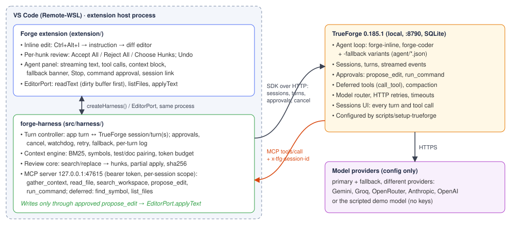

---
pdf_options:
  format: A4
  margin: 10mm 14mm
stylesheet: writeup.css
---

# Forge — a VS Code coding agent on TrueForge

Repository: https://github.com/riyajenson/forgeathon · Video: https://drive.google.com/file/d/1iol4V8OX0IGQ95BHoVEmTl59FTz9snNn/view?usp=sharing · Techfest Team ID: TM-C5CB9D87285

## 1. Team

Riya Jenson (GitHub `riyajenson`, Vellore Institute of Technology, Vellore) · Shriya Prasad Sawant (GitHub `shriyapsawant21-wq`, Vellore Institute of Technology, Vellore) ·
Akil Ansari (GitHub `dumbly-smart`, Vellore Institute of Technology, Vellore) · Divyam Agrawal (GitHub `divyamagrawal06`, Vellore Institute of Technology, Vellore)

## 2. Starting point

Built **from scratch**; not a fork of any editor or agent. The first commit is a TrueForge 0.185.1 feasibility
spike (`spike/FINDINGS.md`); the VS Code extension was scaffolded from an empty folder. TrueForge itself is
used unmodified as the harness (`npx @truefoundry/trueforge@0.185.1`, local mode, SQLite).

## 3. Architecture on TrueForge

**TrueForge owns the agent loop.** Two agent definitions live in the repo (`agent/forge-inline.json`,
`agent/forge-coder.json`); the setup script registers them with the primary model and generates
`-fallback` variants with the fallback model. Subagents, generative UI, ask-user and the sandbox are off;
compaction is on (60k input tokens); iteration limits 8 (inline) and 60 (agent).

**Harness (`forge-harness`).** Maps each editor turn to a TrueForge session/turn via the TrueForge SDK
(`createTurnStream`, `subscribeToTurn`, `createTurnEvents`, `sessions.cancel`), normalises the event stream
(text, tool calls, results, context report, review/command requests, fallback, done) and handles approvals:
on `tool.approval_required` it computes the hunks, waits for the user's per-hunk decision and answers
TrueForge with allow/deny (the deny reason reaches the model). **Harness-enforced guardrails** (not left to
the prompt): a per-turn command budget (5 agent, 1 inline; later `run_command` calls are refused to the model
without prompting and the panel shows "command budget reached"; 2 kept for pytest, plus one rerun after a
fix; `cd … && …` is refused with the corrected call, free), approved commands run in **bubblewrap** (read-only
checkout and host, private `/tmp`, no network, no provider keys in its environment; refused if unavailable;
it can still read files, see section 8), a tool still running after a
turn holds the session (no retry or fallback until it ends).

**Editor tools are MCP tools** served by the harness inside the extension host (127.0.0.1, bearer token):
`gather_context`, `read_file`, `search_workspace`, `propose_edit`, `run_command`, and the **deferred**
`find_symbol` and `list_files` (loaded on demand through TrueForge's `call_tool`). Only `propose_edit` and
`run_command` require approval. TrueForge sends `x-tfg-session-id` on every MCP call, so an approval can be
used only by the tool call of the same session, once, with the same arguments.

**Diff safety.** `propose_edit` never writes by itself. The approved text (the original with only the accepted
hunks applied) goes to the editor's `applyText`, which checks the buffer hash, applies one `WorkspaceEdit`, saves,
and returns one of six outcomes (stale, approval missing, failed before apply, applied but unsaved, save failed,
saved). The reviewed text is verified by hash; save-time formatters may alter the saved file. Undo, guarded by
the post-save hash, restores the reviewed original text (saved without save participants).

**Cancellation.** Stop closes the approval gate, cancels the TrueForge turn, kills a running command's
process group and closes the open review; an approved command never starts after Stop. `done` waits (bounded) for in-flight tool calls, because TrueForge 0.185.1 reports the turn
cancelled before an MCP call returns. If Stop comes after an approved edit reached VS Code, that edit is saved and
reported before `done` (tested); edits saved earlier stay, so a stopped multi-file task can be partly done. Waits on TrueForge are bounded: if it stays silent, the harness stops
observing after twice the cancel timeout and ends the turn exactly once. A tool still running when the turn
ends is waited for until it finishes (the command timeout, at most 600 s, or Stop). Retry and fallback happen only when
every tool call of the failed attempt has settled and no approved edit or command is unfinished.

## 4. How context is selected

1. **Pinned first:** the user's selection, `@symbol:Name` (resolved through the symbol index),
   `@file:path`, then an outline of the active file. Automatic results cannot displace these choices.
2. **Automatic retrieval:** the workspace is chunked into functions, classes, and doc sections. BM25 searches
   split identifiers and prose; symbol, decorator, exact path, and inverse-document-frequency path terms add
   evidence when filenames matter more than body wording. Code, tests, and docs are joined by bounded
   one-hop imports, reverse importers, test names, and symbol mentions.
3. **Budgeted packing** (default 4,000 estimated tokens, chars/4; resent with every request): up to eight
   query-focused outlines use at most 120 estimated tokens each. Relevant chunks are packed next; a large
   chunk is represented by a focused excerpt capped at 600 tokens and 30% of the total budget. The excerpt
   marks omitted lines and tells the agent to read the full file before editing. Everything else appears in
   **skipped** with a reason. The ranked paths and reasons are visible in the context report.
4. The agent can request more context with `gather_context`; explicit choices, automatic selections, ranks,
   token use, omissions, and skipped paths remain inspectable.
5. **Selective semantic ranking** (`forge.context.semanticSearch`, on by default): only weak lexical/structural
   shortlists are considered. Fully cached semantic scores can reorder that shortlist synchronously. On a cache
   miss, Forge returns the lexical/structural result immediately and warms vectors in the background for later
   requests. The optional CPU runtime is installed with `scripts/enable-semantic-search.sh` (~230 MB); when it
   is absent or fails, the context report explains why the deterministic fallback was used.
6. **One read policy for every source** (retrieval, `@file`, `@symbol`, selection, active file, and the
   `read_file`, `search_workspace`, `list_files`, `find_symbol`, `gather_context` tools): credentials-shaped
   files (`.env*`, keys, `.netrc`, …) are never sent and are reported as skipped or refused; binary files are
   refused; `read_file` output is capped (600 lines / 60,000 characters), each cut marked. Detection is by file name.

The workspace index is built in the background at start-up and reused. On the 13-task Forge + pinned Flask 3.1.3
retrieval benchmark, the default 4,000-token budget improved recall@5 from 0.699 to 0.801 and MRR from 0.660 to
0.733 versus the prior single-run baseline. Relevant-file density changed from 0.461 to 0.492 files per 1,000
packed tokens. The number of labeled expected files present in packed context rose from 9/30 to 25/30. Median
assembly changed from 4.55 ms to 4.04 ms, an 11.1% reduction. Thus this same-budget run improves
retrieval and file coverage but does not improve every metric, and it does not establish a 50% gain across the
board.

At 8,000 tokens, the older single run measured recall@5 0.699, MRR 0.660, density 0.244, and 203.16 ms median
assembly with the old cold/missing-semantic wait. Three current runs measured 0.801, 0.733, 0.315, and a median
4.06 ms, respectively. Most of the latency difference comes from returning immediately on semantic cache
misses. The semantic ranking quality was deliberately not included in these comparisons: benchmark inference
was disabled to isolate lexical and structural retrieval. These results are directional; the baseline was a
single run and source-index contents changed as the implementation evolved.

## 5. Model setup

| Role | Model | Hosting | Approx. cost for the demo |
|---|---|---|---|
| Primary | `nvidia/nemotron-3-ultra-550b-a55b` | NVIDIA API Catalog, free tier | $0 |
| Fallback | `nvidia/nemotron-3-ultra-550b-a55b:free` (same model; NVIDIA serves it upstream; 50 requests/day without credit) | OpenRouter, free model | $0 |
| Spare: configured; fallback in earlier rehearsals, before OpenRouter replaced it | `qwen/qwen3.8-27b` | Groq, free tier | $0 |

Models are configured only in TrueForge, from `config/models.json` via `node scripts/setup-trueforge.mjs`;
**switching models is a config change plus rerunning setup** (or `scripts/use-models.sh openrouter-free`, one of three named profiles). The NVIDIA catalog offered no Qwen3 Coder or
DeepSeek model. Probed once each: Kimi K3.1 Pro, GLM-5.3 Flash, Step-5, Mistral Large 4, MiniMax M3.1 Flash; Nemotron-3 Ultra was the
fastest with correct streamed tool calls. Gemini,
Anthropic and OpenAI appear in the example config only and were never run. **Real-model evidence:** the first round-1 build passed
A, B, C (tag `round1-submission`). This updated build, 21 Nov (`docs/writeup/rehearsal.json`): Task B passed 6/6 in 3 of 3
runs (92–124 s, 25–27 requests, ~1M input tokens), then A, B, C passed on the final commit (B: 30 requests, 244 s). TrueForge resends a 429'd model request up to 4 times (1–8 s backoff) below the
turn. Then the harness's policy, for failures before any write: authentication errors fall back immediately;
unreachable/timeouts/5xx/429 retry once (429 waits for the provider's `Retry-After` hint, capped at 30 s) and
then fall back to the `-fallback` agent, which **starts a fresh TrueForge session**. There is **no retry or
fallback after a write** (or while a tool call is unsettled): the turn ends with the error. Errors are classified
from the provider's status and wording. The free fallback shares NVIDIA's backend, so it covers throttling and
key problems, not an NVIDIA outage. A
watchdog stops a turn that streams nothing for 45 s.

## 6. Scorecard

| Criterion (points) | What we show ([video] recording · [native test] VS Code UI tests · [harness rehearsal] `rehearsal.json`) | Video |
|---|---|---|
| Inline edit (10) | [video] Task A: selection → instruction → in-editor diff → hunk picker → accept → saved → verification `False`. [native test] choosing one hunk saves exactly that hunk | 00:03 |
| Agent mode (10) | [video] Task B: no files named; the agent finds and edits `cli.py`, `test_cli.py`, `docs/cli.rst`; the panel lists the changed files at turn end. [harness rehearsal] B passed on `f67c719` (3 files, 5 reviews, 37 requests); this build: 3 of 3 runs and the rehearsal | 00:52 |
| Streaming / cancellation (10) | [video] streamed text, context and tool calls. [native test] Stop during a pending review or a running command → cancelled, nothing applied; Stop after an approved edit reached VS Code → that edit is saved first | 00:40 |
| Context assembly (15) | [video] Context block: used/budget, ranked files with reasons, skipped items | 00:54 |
| Diff safety (10) | [video] hunk picker; Undo restores the file (`git status` empty). [native test] partial accept, undo after each hunk | 00:21 |
| Resilience (10) | [video] Task C: invalid primary key → fallback banner → ✕ (reject all hunks) → `git status` clean. [harness rehearsal] C passed (401 → OpenRouter) | 03:17 |
| TrueForge depth (10) | [video] Session view of Task B: the turn, its tool calls and approvals (deferred tools via `call_tool` only if the model uses them) | 03:05 |
| Demo video (10) | [video] Tasks A, B, C in order, each verified on screen | A 00:03 · B 00:52 · C 03:17 |
| PDF write-up (15) | This document (`docs/writeup/WRITEUP.pdf` in the repository); [video] the closing frame links the repository | 03:51 |

Timestamps: current video, recorded on the first round-1 build (Accept All / Reject All prompt); this build
uses a multi-select hunk picker (✓ / ✕), covered by the native UI tests.

Automated checks use a **scripted model** that supplies Task B's paths and edits: they show the plumbing, not
discovery. `scripts/e2e-mock.sh` (A, B, C, guardrails; 21 checks), `scripts/test-extension-e2e.sh` (A, B, Stop, C in
VS Code), 163 unit and 20 integration tests against TrueForge 0.185.1. Responsiveness (host blocks ≤ 150 ms, webview
renders ≤ 100 ms) passed 3/3 suite runs (peaks 49–106 ms) and fails an injected 200 ms stall; one earlier run had
an unexplained 605 ms block in VS Code's `postMessage`.

## 7. Tools used

- **TrueForge 0.185.1** (agent harness), **TrueForge SDK**, **MCP TypeScript SDK**, VS Code extension API,
  TypeScript, Node.js, Python/pytest, `@vscode/test-electron`.
- **Demo video:** recorded by an automated UI script (Playwright over the Chrome DevTools Protocol) driving the
  real extension in VS Code with real models (NVIDIA primary, OpenRouter fallback) and the local TrueForge 0.185.1;
  no simulated output. Only model waiting time and operator holds were cut, each cut captioned on screen.
- **AI coding assistants (declared as required):** **Claude** (Anthropic; Claude Code CLI and Claude chat) —
  TrueForge spike, harness architecture and implementation, context engine, tests, and, after the hand-over,
  the editor workstream, documentation and this write-up draft. **OpenAI Codex (via ChatGPT)** — the initial
  VS Code extension scaffold, editor features (EditorPort, inline review, agent panel) and the shared
  contracts; PRs #3 and #4 (execution-safety sandbox for commands, tool-call settlement, retrieval coverage
  reporting, the submission-evidence checker); and a QA review of the 19 Nov build. All code was reviewed and
  directed by the team.

## 8. Known limitations and what you would do with another month

**Limitations.** Development and automated tests used a scripted model; real-model behaviour was checked in
a few runs with one model pair. In Task B the real model over-verified (7–17 commands) and split one file's edits over several reviews despite
instructions (one run spent its budget on `python -c` checks, then left a failing test), hence the harness command budget (last 2 runs kept for pytest); each step resends the whole conversation. Retrieval is
lexical by default (semantic reranking is ~178× slower). The symbol index covers Python only; ranking weights were tuned on Flask. **`run_command` is write-protected, not confidential:** bubblewrap
makes the checkout read-only and cuts the network, but an approved command can read any file you can; it needs
Linux/WSL with bubblewrap (otherwise commands are refused), and tests that write into the tree or need the
network fail by design. Free tiers limit Task B: on 19 Nov NVIDIA throttled at
9–15 requests/min, Groq's free tier (7,000 tokens/min) cannot take B's ~11k-token requests, and the OpenRouter
fallback allows 50 requests/day without credit (one B takes 40–70). Compaction is configured but the
demo tasks never reach the threshold. One workspace
folder; tested on WSL only.

**With another month:** faster embeddings and language-server symbols for retrieval, evaluated across repositories and
models; per-hunk CodeLens; conversation history across fallback; read confinement for
`run_command`; cost-aware model routing; Marketplace packaging.
